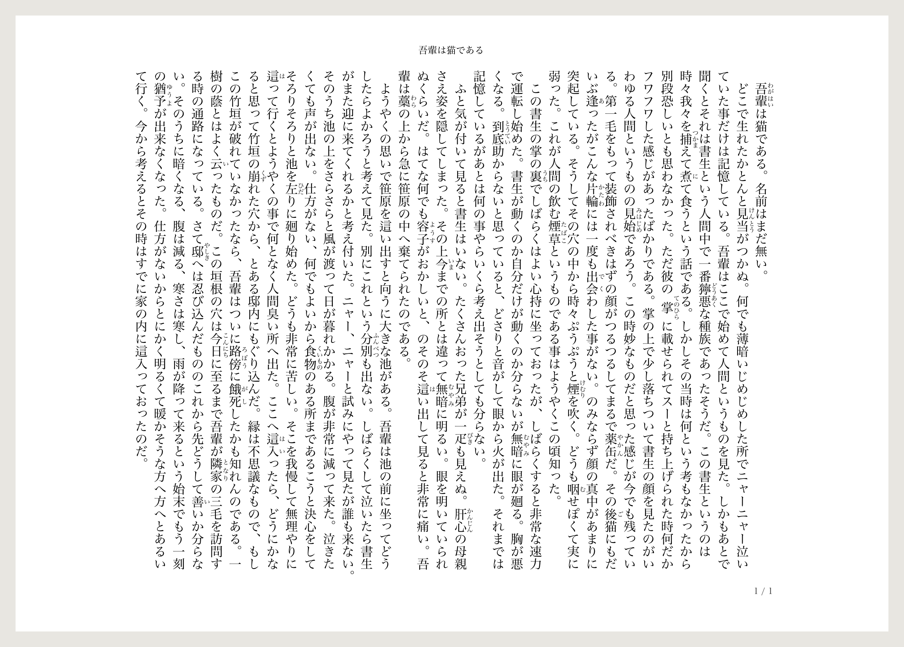
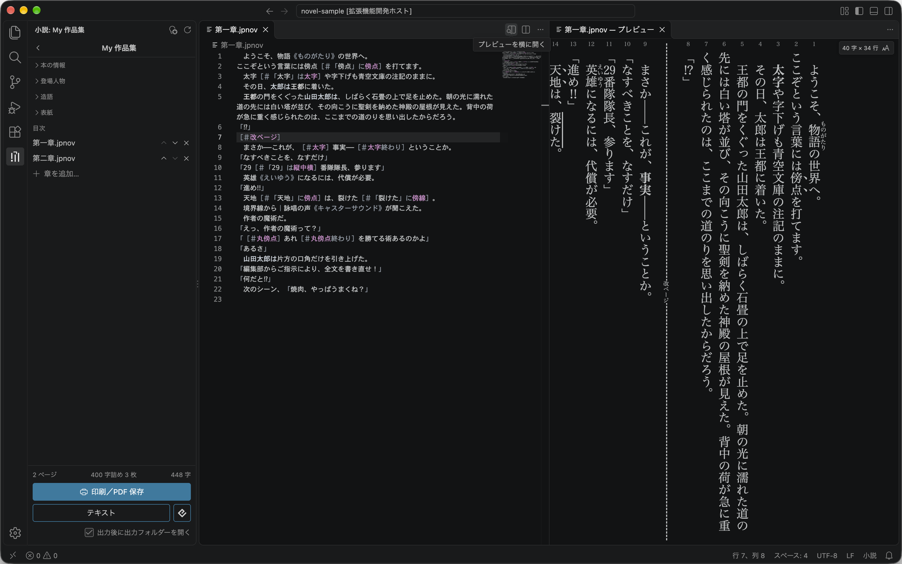
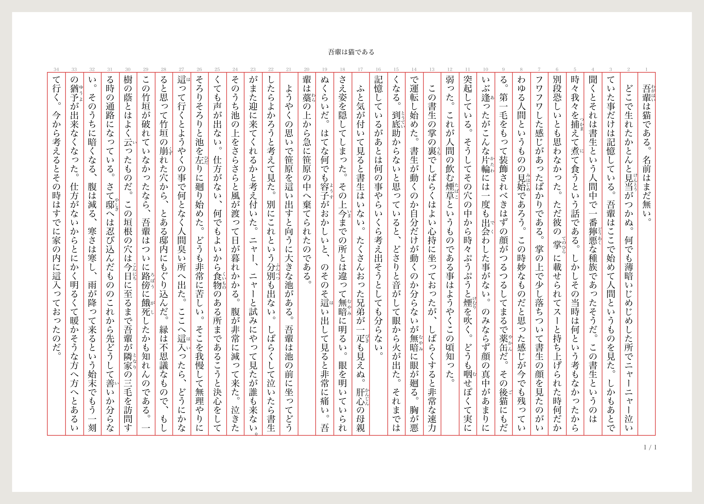
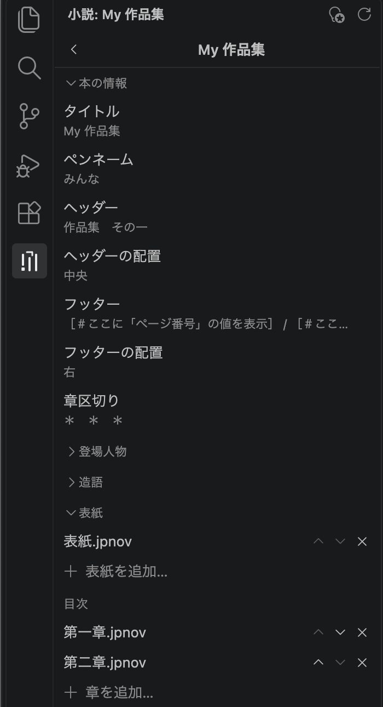
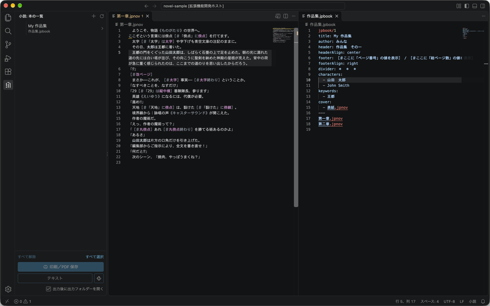
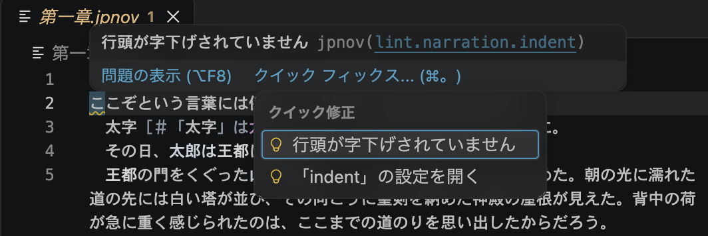

# Japanese Novel

[日本語](./README.md) | English

Write, proofread, and typeset Japanese novels in Visual Studio Code — vertical
layout, [Aozora Bunko](https://www.aozora.gr.jp/annotation/index.html) markup,
one-command HTML / EPUB / text builds, printing straight from your browser.
No AI anywhere in the writing path (see [No-AI policy](#no-ai-policy)).



*A printed page of the built output, unretouched: the opening of Natsume Sōseki's* I Am a Cat *(Aozora Bunko).*

## Features

- **Vertical preview** — live, cursor-following 縦書き rendering beside the editor,
  using the same layout engine as the builds.
- **Aozora Bunko annotations** — ruby (including both-side), emphasis dots, side
  lines, bold/italic, tate-chū-yoko, indents, page breaks.
- **Auto indent** — every Enter starts the new line with a full-width space;
  open it with `「` or `『` and the space is removed.
- **Book builds** — collect chapters into a paginated vertical HTML file which can
  be **Print / Save as PDF**, EPUB, or a concatenated Aozora-format text.
- **Proofreading** — hygiene checks on by default, opt-in manuscript-convention
  lints, quick fixes and a fix-all action.
- **Cast & keyword highlighting** — semantic colouring of character names and
  coined terms in narration.
- **Annotation help** — hover an annotation for what it does and what it
  applies to; F2 renames a forward-ref target together with the text it names.



*The everyday writing layout: the book's table of contents, the manuscript, and the vertical preview in one window.*

## Design stance

- **No AI.** Nothing in the writing path involves AI; Copilot is disabled by
  default for `.jpnov` / `.jpbook` (see [No-AI policy](#no-ai-policy)).
- **Dictionary-free.** No morphological analysis, no bundled word lists —
  ordinary words are never flagged, and every coined term you declare is
  recognised. What deserves highlighting is the author's call; the lint rules
  reason about structure.
- **Fully offline.** Everything ships bundled: no post-install downloads, no
  network traffic, an instant preview. Printing opens a local file in your own browser.
- **Non-invasive.** Sources are plain text in Aozora notation under dedicated
  extensions (`.jpnov` / `.jpbook`), so no `.txt` / `.md` project is ever
  touched, and the manuscript outlives the tool.

## Quick start

1. **Make a book.** Open the **Books** view in the Activity Bar (the
   **Japanese Novel** book icon) and click **Create a Book…** (`+`): the
   input box already holds `.jpbook`, so type only the name before it. The
   new book opens right there with its **Book Info**, **Cover pages** and
   **Chapters** sections. One `.jpbook` is one book: a plain text file with
   one chapter path per line, each counted from the `.jpbook`'s own folder
   (`../` reaches up, as in an import); move the book inside VS Code and its
   paths are rewritten to keep naming the same files. The lines above its `---` carry the
   book's own metadata — title, running head, page-number style (see
   [Per-book metadata](#per-book-metadata)); Create a Book writes them all.
   Editing the file by hand does the same thing the view does.
2. **Write chapters.** Click **Add chapters…** under **Chapters**, type a
   name and press Enter: the `.jpnov` file is created, listed in the book,
   and opened in the editor. Aozora Bunko annotations are highlighted as you type;
   click the preview icon in the editor title bar (**Japanese Novel: Open
   Preview to the Side**) to write beside the vertical layout.
3. **Build it.** Click **Print / Save as PDF** at the bottom of the view: the
   book opens in your browser, and the same button floating on the page
   (印刷／PDF 保存) brings up the print dialog — print on paper, or choose
   Save as PDF there for a PDF.
   The text and EPUB buttons sit beside it. With a book open, the buttons
   build just that book; back in the list, they build every checked book.

Chapters and book files can live anywhere: a path counts from the `.jpbook`'s
folder and may leave the workspace folder. Each book builds into the output
folder, named after its file: `books/volume1.jpbook` builds to
`dist/volume1.html`. The folder is `jpnov.layout.outDir`, default
`${workspaceFolder}/dist` — the workspace folder's `dist`, whatever the book's
depth. Any other value counts from the `.jpbook`'s own folder: `dist` puts the
output beside the book, `../dist` one level up. A book under no workspace
folder counts from its own folder either way. Dot-folders, `node_modules` and
a nested workspace folder (a root of its own) are never scanned for books. A workspace folder is
optional: a `.jpbook` open in the editor is listed under **Open files** when
no folder contains it. The extension activates once the window has finished
starting — preview and book editing need no configuration at all. A **Get started with Japanese
Novel** walkthrough covers the same steps.

## A 60-second Japanese typography primer

The terms this document (and the settings UI) uses, for readers who know code
but not Japanese typesetting:

- **Vertical writing (縦書き)** — text runs top-to-bottom, lines advance
  right-to-left, books open "backwards". The preview and the built pages are
  all vertical; the source you edit stays ordinary horizontal text.
- **Ruby (ルビ)** — small reading glosses beside the base characters (furigana).
  In vertical text they sit to the right; a second gloss can sit on the left
  (両側ルビ, "both-side ruby") — often a translation or nuance note.
- **Emphasis dots (傍点)** — the Japanese counterpart of italics: a small mark
  beside every emphasised character. Nine dot shapes plus five side-line styles
  (傍線) are part of the Aozora vocabulary, and all are supported.
- **Tate-chū-yoko (縦中横)** — a short horizontal run ("42", "!?") stood upright
  in a single character cell within vertical text. The run is marked with an
  annotation written after it. A lint rule flags a half-width pair (`!!` `!?`
  `?!` `??`) that has no such annotation; its quick fix replaces the pair with
  the one character that holds both marks (`‼` `⁉` `⁈` `⁇`), or writes the
  annotation when set to `tcy`.
- **Kinsoku (禁則処理)** — Japanese line-breaking prohibitions, applied at every
  wrap in preview and builds alike (`jpnov.layout.kinsoku`, default `strict`):
  opening brackets never end a line; closing punctuation, middle dots, repetition
  marks, small kana and `ー` never start one; `――` and `……` runs never split; and a
  trailing `、`/`。` hangs into the margin (ぶら下げ) instead of pushing text down.
  The full-width space after a `？` or `！` that ends a line is dropped, not carried
  to the head of the next line.
  `relaxed` lets small kana and `ー` start a line and may break a long symbol run
  between pairs (Word's standard level); `none` is a bare wrap at the column width.

  | kinsoku `none` | kinsoku `strict` (default) |
  | :---: | :---: |
  |  |  |

- **Dashes (ダッシュ)** — Japanese novels write a dash as a doubled pair
  (`――`), and it is typeset as one unbroken dash. Pick the
  character you write in `jpnov.lint.common.dash` (default `―`); any other
  dash character, or a run of an odd number of dashes, is flagged with an
  auto-fix; so is a `－－` (full-width hyphen-minus) or `––` (en dash) run
  standing in for one. The prolonged sound mark `ー` is never treated as a
  dash. In HTML and EPUB output, the chosen character is typeset as
  the em dash (`—`), and Japanese fonts join the pair into one unbroken line.

- **Genkō-yōshi (原稿用紙)** — the 20 × 20 manuscript grid Japanese prose is
  drafted on. The default page here is the submission format, **40 characters
  × 34 lines**, and the line pitch
  comes in four steps
  (`jpnov.layout.linePitch`); turn on line numbers and column
  rules for the classic manuscript-paper look, shown here at the 2× pitch:

  

- **Aozora Bunko notation** — the de-facto plain-text markup for all of the
  above, used by Japan's public-domain digital library. Sources stay portable:
  a `.jpnov` file is meaningful with or without this extension.

## Annotations

Novel sources use [Aozora Bunko annotations](https://www.aozora.gr.jp/annotation/index.html).
Recognised forms are highlighted and rendered; anything else passes through as
an HTML comment (never an error), so unusual markup degrades quietly.

Most annotations take a **forward-ref** form: the annotation follows the text it applies to and names it. Where the range is easier to bracket, a **start / end** pair wraps it inline; for multi-line ranges a **block** form puts the start and end annotations on their own lines. All spellings render the same.

| Effect | Forward-ref form | Start / end form | Block form |
| --- | --- | --- | --- |
| Ruby | `漢字《かんじ》` | `｜親文字《ルビ》` | — |
| Left ruby 左ルビ | `［＃「対象」の左に「よみ」のルビ］` | — | — |
| Tate-chū-yoko 縦中横 | `対象［＃「対象」は縦中横］` | `［＃縦中横］…［＃縦中横終わり］` | — |
| Emphasis dots 傍点 | `［＃「対象」に傍点］` | `［＃傍点］…［＃傍点終わり］` | — |
| Side line 傍線 (5 styles) | `［＃「対象」に傍線］` (傍線/二重傍線/鎖線/破線/波線) | `［＃傍線］…［＃傍線終わり］` | — |
| Bold 太字 | `［＃「対象」は太字］` | `［＃太字］…［＃太字終わり］` | `［＃ここから太字］…［＃ここで太字終わり］` |
| Italic 斜体 | `［＃「対象」は斜体］` | `［＃斜体］…［＃斜体終わり］` | `［＃ここから斜体］…［＃ここで斜体終わり］` |
| Heading 見出し | `第一章［＃「第一章」は大見出し］` (大見出し / 中見出し / 小見出し) | `［＃大見出し］…［＃大見出し終わり］` | `［＃ここから大見出し］…［＃ここで大見出し終わり］` |
| Indent 字下げ | `［＃○字下げ］` (○ full-width spaces where it stands) | — | `［＃ここから○字下げ］…［＃ここで字下げ終わり］` |
| Page break | `［＃改ページ］` (on its own line) | — | — |


The specimen is typeset at 2× line pitch for the left ruby. Its source —
paste it into a `.jpnov` to try:

```text
　物語《ものがたり》が始まる。
　｜お茶の間《おちゃのま》へ届け。
　覚悟［＃「覚悟」に傍点］を決めた。
　運命［＃「運命」に波線］が動く。
　英雄《えいゆう》［＃「英雄」の左に「ヒーロー」のルビ］の登場。
　第42［＃「42」は縦中横］話、太字［＃「太字」は太字］で。
「何だと!?［＃「!?」は縦中横］」
```

Notes: 傍点/傍線 take a left-side variant spelled differently in each form — the
**forward-ref** form uses `の左に` (`［＃「対象」の左に傍点］`), the **start / end**
form uses bare `左に` (`［＃左に傍点］…［＃左に傍点終わり］`); bold/italic use the
connector **は**. Indent counts (`○`) are **full-width digits** (２, １０), ９９ at most; a larger
one is left unapplied and raises an editor **Warning**. A `［＃○字下げ］` is ○ full-width
spaces at its position, so wrapped continuation lines return to the margin; the block indent
indents them too. An unclosed start / end or block annotation
(`［＃太字］` or `ここから…` with no `…終わり`) still renders to the end of the file but
raises an editor **Warning**, as does a `…終わり` with nothing open and a `《…》` reading
with no base text before it or an empty `《》` (both print as typed; the former carries a
quick fix respelling it as the 二重山括弧 外字注記 below); an unclosed `［＃`
is an **Error**. An
explicit `｜` base runs up to the `《` even across annotations inside it
(`｜山田［＃「山田」に傍点］《やまだ》` is one ruby, dotted). Italic relies on the browser
synthesising an oblique for Japanese fonts.

**Left ruby** puts a reading on the left of the preceding text; pair it with an
ordinary right ruby for 両側ルビ (`青空文庫《あおぞらぶんこ》［＃「青空文庫」の左に
「aozora bunko」のルビ］` — the annotation names the base only, never the `《》`
part). Left readings are exempt from the ruby-kana lint, since they are often
Latin. Left ruby needs room to the left of the line — set
`jpnov.layout.linePitch` to `2` or wider. At tighter pitches the reading
overlaps the neighbouring line. **縦中横** stands a short run upright in one
square — keep it to 3 characters or fewer (a longer run is squeezed to fit
and raises a Warning). A half-width pair (`!!` `!?` `?!` `??`) takes the same
annotation (`!?［＃「!?」は縦中横］`); without it the pair lies on its side, two
squares long. A lint rule flags a pair that lacks it
(`jpnov.lint.common.questionExclamationMarks`). Its quick fix depends on the
setting: `fullWidth`, the default, replaces the pair with the one character
that holds both marks (`!!` → `‼`, `??` → `⁇`, `?!` → `⁈`, `!?` → `⁉`); `tcy`
writes the annotation. The rule skips a run of three or more marks, and a pair
inside a ruby (its base, its reading, the base of a left ruby) or inside a
`《…》` that made no ruby. Under `fullWidth`, an annotation that names the pair
whole (`［＃「なに!?」に傍点］`) is rewritten with it (`［＃「なに⁉」に傍点］`);
one that takes only one mark of the pair (`［＃「に!」に傍点］`) is left as
written and reported, since its target is gone. Under `tcy`, where another
annotation's target takes only one mark of a pair, the rule flags the pair and
offers no fix: once annotated, the pair is one character, and the other
annotation would have no effect.

**Hover, highlight and rename.** Hovering an annotation shows what it does and
what it applies to: the text a forward-ref form bound to, or the start / end it
pairs with (with its line), with a link to the Aozora Bunko page for that kind.
Placing the cursor on an annotation highlights its target or its partner, and
the cursor on the text highlights the annotations bound over it. F2 on a
forward-ref target (`言葉［＃「言葉」に傍点］`, on either `言葉`) renames the
text and every `「…」` naming it together; it is offered only where the `「…」`
is written exactly as the text it bound to (no ruby, annotation, value or 外字
inside the range, kana composed alike), otherwise the editor says so.

**外字注記** (external-character annotations) are recognised for eight characters. In
body text, `※` directly followed by one of these annotations is one character:
`※［＃感嘆符二つ、1-8-75］` (`‼`), `※［＃疑問符二つ、1-8-76］` (`⁇`),
`※［＃疑問符感嘆符、1-8-77］` (`⁈`), `※［＃感嘆符疑問符、1-8-78］` (`⁉`),
`※［＃逆感嘆符、1-9-3］` (`¡`), `※［＃逆疑問符、1-9-22］` (`¿`),
`※［＃始め二重山括弧、1-1-52］` (`《`) and `※［＃終わり二重山括弧、1-1-53］` (`》`). Any other
`※［＃…］` is a `※` and a comment. `《…》` always means ruby, so the brackets are
written this way (`スキル※［＃始め二重山括弧、1-1-52］聖剣※［＃終わり二重山括弧、1-1-53］`).
The first six can also be typed as they are; Shift JIS has no code for them, so a
Shift JIS `.txt` build writes each as its annotation, while `《` `》` are written as
themselves.

## Auto indent

Japanese novels open each paragraph with one full-width space and leave
dialogue lines starting with `「` or `『` unindented. The editor follows that
convention as you type:

- Pressing Enter starts the new line with a full-width space.
- Open the line with `「` or `『` and the space is removed.
- Press Enter again without typing anything and the leftover space is
  cleared, leaving a true blank line.
- Only spaces inserted automatically are ever removed.

Turn it off under **Japanese Novel — Editor** (`jpnov.editor.autoIndent`).

## Moving, selecting and deleting by word

In `.jpnov` editors, ⌥← / ⌥→ (Ctrl+← / Ctrl+→ on Windows and Linux) stop
partway through a sentence. By default, VS Code jumps to the start or end of
the line: it only breaks words at ASCII punctuation and spaces, so it treats a
Japanese paragraph as one word. Add ⇧ to select up to the next stop; ⌥⌫ / ⌥⌦
(Ctrl+Backspace / Ctrl+Delete) delete up to it.

The stops follow a rough split by script. Hiragana after kanji or katakana
stays with them, a run of one script stays together, and so does a run of
punctuation and spaces, cut before an opening bracket and after a closing one.
`ぱっともらった` is one piece, and a sentence splits into
`聖剣を / 抜いたのは / 山田 / 　 / 太郎だった / 。`. Each stop depends only on
its neighbouring pieces, so left and right moves stop at the same places.

VS Code's own behaviour applies during IME composition, and to the move
commands while a screen reader is running on Windows. To opt out, remove the
keybindings for the **Japanese Novel** word commands in Keyboard Shortcuts.

## Preview

Open it from the editor title bar (**Open Preview to the Side**) on any
`.jpnov`. The preview is a continuous vertical flow re-rendered as you type;
it follows the editor cursor, wraps and breaks lines with the exact engine the
builds use, and shows `［＃改ページ］` as a labelled dashed marker. A faint dotted
line marks where each page would end at the configured lines per page. Line numbers
(on by default, running through the whole chapter) and manuscript-paper column rules
are toggled under **Japanese Novel — Layout & Output**.

A small chip at the preview's top right shows `40 chars × 34 lines`. Click it to
open the controls and change the characters per line and lines per page on the spot.
The values apply to the preview only. While they differ from the settings the chip
turns yellow and gains two buttons: save writes them to your user settings or the
open folder's workspace settings, reset restores the values from the settings. Click anywhere else and the
chip folds back to the one-line summary.

## Building books

The **Books** view in the Activity Bar lists every discovered `.jpbook` as
a book with a checkbox (labelled by its `title`). The buttons at the bottom of the view build the checked books (EPUB
is an icon button):

- **Print / Save as PDF** — builds the HTML and opens it in your default
  browser. The same button floating on the page (印刷／PDF 保存)
  brings up the browser's print dialog; print on paper, or save it as a PDF
  instead. Use Chrome (recommended) or Firefox. Safari is not recommended:
  it ignores the paper size and orientation the HTML declares (`@page size`),
  so you would have to pick them in its print dialog (landscape by default)
  and leave its headers and footers off. The `.html` itself lands in the output
  folder: one standalone, paginated vertical file per book (inline CSS, no
  external assets) that prints the same way whenever you reopen it.
- **TXT** — the chapters concatenated as Aozora-format `.txt` (an
  annotation still open at a chapter's end is closed at the seam, so the
  chapters render exactly as in the HTML build).
- **Build to EPUB** — a reflowable EPUB 3 per book: vertical writing and
  right-to-left page turning carry over into the reader, while font size and
  line wrapping follow the reading device. One spine file per chapter, split again
  at ［＃改ページ］.

Outputs land in `<outDir>/<name>.{html,epub,txt}`, `<name>` being the
`.jpbook`'s file name without the extension and `outDir` defaulting to
`${workspaceFolder}/dist` (a value without the token counts from the
`.jpbook`'s own folder). Two book files built together that resolve to the same
output file fail the build with a diagnostic, and neither is written. A `.jpbook` with
an error (a missing metadata key or
closing `---`, a backslash in a path, an entry that is not a `.jpnov` file) fails that
book's build with its first error; the other books still build. Warnings, such
as unknown keys or duplicates, never stop a build.

Chapters and the `.jpbook` itself are taken as the editor shows them: an open
file contributes its current text, unsaved edits included, so a build matches
the preview; a closed file is read from disk with the encoding VS Code picks
for it (`files.encoding`, `files.autoGuessEncoding`, a byte order mark). Keep
`files.autoGuessEncoding` on if you bring in manuscripts saved by other apps,
such as Windows Notepad. A Shift JIS manuscript that reads correctly in the
editor builds correctly; a file VS Code cannot decode as text fails that
book's build with `cannot read "…": not a text file`.

A PDF saved from the print dialog embeds a subset of each font it uses. With
the default stack, the result is fine to submit to a print shop and to sell:
Hiragino Mincho (macOS) and Yu Mincho (Windows) are OS-bundled fonts whose
licences permit commercial use of rendered output and PDF embedding, and Noto
Serif JP is openly licensed (SIL OFL). When `jpnov.layout.fontFamily` names a
commercial font, check that its licence allows PDF embedding.

A `.jpbook` is a reading-order table of contents — file names and folder
layout never decide what a book contains or in what order. That scales to long
works. Keep one `.jpbook` per volume and send your editor only the newest
volume. Keep alternate drafts of a chapter side by side and swap a
single line to retarget a submission. Name and move chapter files freely; the
book keeps its order.

The built output has no table-of-contents page yet. Headings come from
annotations (see [Annotations](#annotations)): a line carrying a heading
annotation is a heading as a whole, set in a bold gothic (sans-serif) face at
the body size, and the three levels look the same.
Chapters appear in the order the `.jpbook` lists them.

On `.jpbook` files the editor offers completion (chapter paths, metadata keys,
and enum values), diagnostics (missing files, duplicates, unknown metadata
keys…), and document links — Cmd/Ctrl-click an
entry to open the chapter.

The Books view edits books, too. Open one to see its **Book Info**,
**Cover pages** and **Chapters** sections, and at the bottom the body's page count,
manuscript-sheet count and character count (counted as the build lays it out;
cover pages are not counted): **Add chapters…** ticks in files
you already have and creates new ones from a typed name, dragging (or the
arrow buttons) reorders them, and **×** takes an entry
out of the book while keeping the file. From the keyboard, ↑/↓ move between
entries, Alt+↑/↓ reorder them, Delete or Backspace takes one out, and Esc
returns to the list. **Cover pages** manages the `cover`
list the same way (see [Submission cover sheets and title
pages](#submission-cover-sheets-and-title-pages)). Expand **Book Info** and
click a row to edit that value in place; the buttons at the bottom build only
the open book.
Every action rewrites the `.jpbook` text itself, so the view and
hand-editing always agree.



Renaming or moving a chapter, a folder of chapters, or a `.jpbook` itself
inside VS Code offers to update every `.jpbook` whose paths it affects —
`jpnov.editor.updateRefsOnFileMove` picks `prompt` (default), `always`, or
`never` — the same three choices VS Code offers for updating imports on file
move. A book moved together with its chapters needs no update. Renames made
outside VS Code can't be tracked; the missing path is flagged in the editor
instead.

### Per-book metadata

Page furniture belongs to the book: two volumes in one workspace can carry
different running heads, and the chapter divider is part of a book's identity
too. A `.jpbook` therefore opens with the header line `jpbook/1` (the format
and its version), then its metadata, one `key: value` line each, closed by a
`---` line that the chapters follow. Create a Book writes exactly this:

```text
jpbook/1
title: 作品名
author:
header:
headerAlign: center
footer: ［＃ここに「ページ番号」の値を表示］ / ［＃ここに「総ページ数」の値を表示］
footerAlign: right
divider:
---
01_prologue.jpnov
02_chapter1.jpnov
```

| Key | Template value | Meaning |
| --- | --- | --- |
| `title` | the file name | Display name in the Books view and the EPUB title (the output file name still derives from the file name); never empty |
| `author` | empty | Author name; becomes the EPUB creator metadata; empty for none |
| `header` | empty | Running head at the top of every page; empty for none |
| `headerAlign` | `center` | Header placement: pinned (`right`, `left`), alternating per page (`rightLeft`, `leftRight`), or centred (`center`) |
| `footer` | `［＃ここに「ページ番号」の値を表示］ / ［＃ここに「総ページ数」の値を表示］` | Footer line, `12 / 215` with the template value; empty suppresses it |
| `footerAlign` | `right` | Footer placement: pinned (`right`, `left`), alternating per page (`rightLeft`, `leftRight`), or centred (`center`) |
| `divider` | empty | Chapter divider inserted between chapters that do not open with a heading (e.g. `＊　＊　＊`); a bare mark is centred along the line at build time, a `［＃３字下げ］` prefix indents it instead; empty for a single blank line |
| `cover` | — | Cover pages placed before the body: a cover sheet, a title page, a synopsis (see below); a single page may be written inline as `cover: cover.jpnov` |
| `characters` | — | The cast, one name per item, ruby allowed; highlighted in the narration (see [highlighting](#character--keyword-highlighting)) |
| `keywords` | — | Coined words, one per item, ruby allowed; bolded in the narration (see [highlighting](#character--keyword-highlighting)) |

The header is the first line, exactly `jpbook/1`: a first line that is anything
else, or that names a version this extension has no parser for, fails the build,
and nothing below it is read. A key that is not written is an empty one; `title`,
`headerAlign` and `footerAlign` cannot be empty, so a book without them is not
built, and its `---` line is flagged. Unknown keys
warn and are ignored, so future keys stay forward-compatible. The seven keys from `title` to `divider`
are also editable from the **Book Info** rows in the Books view, `cover`
from its **Cover pages** section, and the two lists from its **Characters** and
**Keywords** sections.

The header and footer take the same value annotations as a cover page (below), plus
ページ番号, the current page; any other annotation or ruby prints as typed.

### Submission cover sheets and title pages

Competition guidelines routinely ask for pages ahead of the manuscript — a cover
sheet, a title page, a synopsis. The files listed under `cover` become those
pages, in order:

```text
jpbook/1
title: 作品名
author: ペンネーム
header:
headerAlign: center
footer: ［＃ここに「ページ番号」の値を表示］ / ［＃ここに「総ページ数」の値を表示］
footerAlign: right
divider:
cover:
  - cover.jpnov
  - synopsis.jpnov
---
chapter1.jpnov
```

Paths work exactly like chapter paths; a single cover page may sit on the key's
own line (`cover: cover.jpnov`). Each file starts a new page. The pages ship in
the HTML build, and so in any PDF saved from it. The running head and page numbering
start on the first body page, however many cover sheets precede it.

The Books view's **Cover pages** section adds, creates and reorders these files
just like chapters; a cover created from **Add cover pages…** starts with the sample below.

A cover file can pull in the book's own metadata:

| Book value | Annotation |
| --- | --- |
| Title | `［＃ここに「タイトル」の値を表示］` |
| Author | `［＃ここに「ペンネーム」の値を表示］` |
| Total pages | `［＃ここに「総ページ数」の値を表示］` |
| Manuscript sheets (the body reflowed onto 400-character 原稿用紙, 20 × 20) | `［＃ここに「原稿用紙換算枚数」の値を表示］` |

```text
［＃５字下げ］［＃ここに「タイトル」の値を表示］
［＃７字下げ］［＃ここに「ペンネーム」の値を表示］
［＃７字下げ］全［＃縦中横］［＃ここに「総ページ数」の値を表示］［＃縦中横終わり］ページ
［＃７字下げ］４００字詰め原稿用紙換算［＃縦中横］［＃ここに「原稿用紙換算枚数」の値を表示］［＃縦中横終わり］枚
```

A build fills in that book's values. The preview shows each annotation's default — タイトル
and ペンネーム print as their own names, 総ページ数 and 原稿用紙換算枚数 as `0` — so one cover
file serves any number of books. To decorate a substituted value, wrap it in the
start/end form (`［＃大見出し］［＃ここに「タイトル」の値を表示］［＃大見出し終わり］`).

ページ番号 defaults to `0`, like 総ページ数. Any other name prints as itself:
`［＃ここに「13」の値を表示］` renders `13`. Values are filled on cover pages and in the header
and footer only; in a body chapter every annotation prints its default. On a line that
carries a value annotation, a 対象文字列 that fails to match is not reported.

The manuscript-sheet count is the number of vertical 20 × 20 manuscript sheets
(400字詰め原稿用紙) the body fills, the unit Japanese literary contests state length in.
Annotations and kinsoku are handled as in the build; a centred chapter divider is counted as
if placed at the line head. The Books view shows the same count when a book is opened.

## Character & keyword highlighting

Declare your **cast** and a few **coined keywords** in the book file — the
`characters` and `keywords` lists of a `.jpbook`, written like `cover` — so they
stand out while you write — handy where Japanese drops the subject:

```text
jpbook/1
title: 作品名　第一巻
author: ペンネーム
headerAlign: center
footer: ［＃ここに「ページ番号」の値を表示］ / ［＃ここに「総ページ数」の値を表示］
footerAlign: right
characters:
  - 山田　太郎
  - 山田《やまだ》花子《はなこ》
  - John Smith
keywords:
  - 王都《おうと》
---
第一章.jpnov
```

- **`characters`** — an item is text with ruby, nothing else (an item holding
  another annotation warns and is ignored). A name splits into surname + given
  at a space and at every ruby boundary — `山田　太郎`, `山田《やまだ》花子《はなこ》`
  and `山田｜花子《はなこ》` all split, `｜山田花子《やまだはなこ》` and `山田花子` do
  not; an implicit ruby base is the run the body gives it, so `山田太郎《たろう》`
  is one word — and the full name, the surname alone and the given name alone
  are all recognised. A character is highlighted only where it reads as a
  **subject**: a name (optionally with one honorific such as `さん` / `先生` /
  `ちゃん`) immediately followed by `は` or `が` — e.g. `太郎は`, `山田さんが`.
  Ten built-in pronouns (`私` `僕` `俺` `彼` `彼女` `あたし` `わたくし` `わし`
  `少年` `少女`) are recognised the same way without being listed. Dialogue inside `「」` / `『』` is left in the body colour; only narration
  is scanned. Matching reads the body's base text, so `山田花子は` and
  `山田《やまだ》花子《はなこ》は` are the same; a reading that differs from the book's
  is never flagged.
- **`keywords`** — coined terms (a fantasy noun, a place, …) are **bolded**
  wherever they appear in narration, without changing colour. If a surface is
  in both lists, the subject form wins.

Matching is exact — no dictionary, no guessing — so ordinary words are never
miscoloured and invented names are always caught. A chapter uses the lists of
**every** `.jpbook` in its folder (the nearest open workspace folder), whichever
book it is in: a series writes a name once, in the volume it first appears in,
and a name written differently (ruby, split) in two volumes warns in both. The
lists take effect in open editors when the book file is saved — no reload, no
rebuild — and the Books view edits them in its **Characters** and **Keywords**
sections. Colouring is delivered as LSP semantic tokens; override the colours
under `editor.semanticTokenColorCustomizations` if you like.



## Proofreading (lint)

Japanese Novel runs prose checks as you write, surfaced as editor diagnostics
with quick fixes (and a **Fix all auto-fixable problems** source action).
Everything is a plain `jpnov.lint.*` setting under **Japanese Novel — Lint**.

Every check knows what it is looking at: narration, dialogue (`「…」`), a
heading line, a ruby reading, an annotation. A narration rule never fires
inside a line of dialogue, a heading hangs free of the sentence-ending rule,
and a kanji run split by an annotation (`聴覚視覚［＃太字］区分装置`) still
counts as one run — the checks see the text the way a reader will.

- **Hygiene checks are on by default** — half-width kana, kana with a
  detached 濁点/半濁点 (`common.noNfd`), zero-width spaces, invalid control
  characters, characters Shift JIS lacks (`common.shiftJisSafe`), trailing
  spaces (`common.noTrailingSpace`), and a half-width space between full-width
  characters (`common.noHalfWidthSpace`) — so a stray malformed or
  invisible character never slips into a manuscript. The dash check (`common.dash`) is
  on too, keeping one dash character throughout.
- **Manuscript-convention checks are on by default too**, each with its own
  switch and message: paragraph indent (`narration.indent`), narration lines
  ending with `。` (`narration.endPeriod` — a trailing `……` or dash still
  wants its `。`), no punctuation right before a closing bracket
  (`dialogue.closingPunct`), no leading space on a dialogue line
  (`dialogue.noIndent`), a space after `！`/`？` (`common.exclamationSpace`),
  a half-width `!?` pair set in one square (`common.questionExclamationMarks`),
  even-count ellipses (`common.ellipsis`), and bracket pairing
  (`noUnmatchedPair`). All but the bracket matcher auto-fixable; a
  symbol-only scene-break line (`＊`) is exempt from the paragraph rules.
- **Stricter checks are opt-in.** Length/run limits (`sentenceLength`,
  `maxTen`, `maxKanjiRun`, `arabicDigits`), blank lines in a row
  (`blankRun`, auto-fixable), the `！？`-pair style, and the ruby-kana rule.

A fix that lands inside text a forward-ref annotation names (`なに！と［＃「なに！と」に傍点］`,
where `exclamationSpace` inserts a space) rewrites the annotation's `「…」` with
it, so the annotation keeps its target; a fix that reaches across the edge of
that text leaves the `「…」` as written, and the annotation is reported.

Syntax problems (an unclosed `［＃` annotation, a dangling block end, a ruby
with no base or no reading) are always reported, independent of lint settings.



## Settings reference

Most settings are window-level; the output folder is resolved per book file
(set it per workspace folder or in user settings). The cast and keyword lists
are not settings: they live in the `.jpbook` files.

### Japanese Novel — Layout & Output

| Setting | Default | Meaning |
| --- | --- | --- |
| `jpnov.layout.charsPerLine` | `40` | Characters per line (15–64), preview and builds |
| `jpnov.layout.linesPerPage` | `34` | Lines per page in builds, and the preview's page-end marks (15–64) |
| `jpnov.layout.linePitch` | `1.5` | Line pitch as a multiple of the character size: `1.5` / `1.75` / `2` / `2.25`; preview and built pages |
| `jpnov.layout.fontFamily` | `""` | Body font as a CSS font-family list: blank uses the default Mincho stack; preview and built HTML |
| `jpnov.layout.kinsoku` | `strict` | Line-breaking rules: `none` / `relaxed` / `strict` |
| `jpnov.layout.preview.lineNumbers` | `true` | Line numbers in the preview, continuous through the chapter |
| `jpnov.layout.preview.edgeLine` | `none` | Column rules in the preview: `none` / `text` / `red` |
| `jpnov.layout.paper.size` | `a4` | Paper size the built pages print at: `a4` / `a6`; the grid scales to fit it, centred |
| `jpnov.layout.paper.orientation` | `auto` | Paper orientation: `auto` (follows the page grid) / `landscape` / `portrait` |
| `jpnov.layout.paper.lineNumbers` | `false` | Line numbers in built pages, restarting per page |
| `jpnov.layout.paper.edgeLine` | `none` | Column rules + page frame in built pages: `none` / `text` / `red` |
| `jpnov.layout.txt.encoding` | `shiftJis` | Encoding of built `.txt`: `shiftJis` / `utf8` / `utf8Bom` |
| `jpnov.layout.outDir` | `${workspaceFolder}/dist` | Output folder: `${workspaceFolder}/…` counts from the book's workspace folder, anything else from the `.jpbook`'s own folder (per workspace folder or user settings) |

The running head and page number are **per-book** properties and live in each
`.jpbook`'s metadata, not in settings — see
[Per-book metadata](#per-book-metadata).

### Japanese Novel — Lint

Threshold rules take an integer or `null` (off). `common.*` rules apply to
narration and dialogue alike, `narration.*` / `dialogue.*` rules to their own
form, and `ruby.kana` to ruby readings.

| Setting | Default | Checks |
| --- | --- | --- |
| `jpnov.lint.common.noHankakuKana` | `true` | Half-width kana (auto-fix) |
| `jpnov.lint.common.noNfd` | `true` | Kana with a detached 濁点/半濁点 (U+3099/U+309A), in annotations and ruby too (auto-fix where the pair composes) |
| `jpnov.lint.common.noZeroWidth` | `true` | Zero-width spaces (U+200B) (auto-fix) |
| `jpnov.lint.common.noControlChar` | `true` | Invalid control characters (auto-fix) |
| `jpnov.lint.common.noTrailingSpace` | `true` | Trailing spaces, space-only lines included (auto-fix) |
| `jpnov.lint.common.shiftJisSafe` | `true` | Characters Shift JIS lacks, written as 〓 in a Shift JIS `.txt` build (`‼` `⁇` `⁈` `⁉` `¡` `¿` are written as their 外字注記) |
| `jpnov.lint.common.dash` | `horizontalBar` | One dash character throughout, always in pairs (auto-fix) |
| `jpnov.lint.common.ellipsis` | `true` | Even-count `…`/`‥` runs; `。。`/`、、`/`・・` stand-ins (auto-fix) |
| `jpnov.lint.common.exclamationSpace` | `true` | A full-width space after `！`/`？` when text continues (auto-fix) |
| `jpnov.lint.common.noHalfWidthSpace` | `true` | Half-width space between full-width characters, or after two or more half-width `!`/`?` (auto-fix) |
| `jpnov.lint.common.questionExclamationMarks` | `fullWidth` | Half-width pairs `!!` `!?` `?!` `??` set in one square (auto-fix): `fullWidth` (one character, `⁉`) / `tcy` (the 縦中横 annotation) / `off` |
| `jpnov.lint.narration.indent` | `true` | Narration lines start with `　` or an opening bracket (auto-fix) |
| `jpnov.lint.narration.endPeriod` | `true` | Narration lines end with `。` (auto-fix) |
| `jpnov.lint.dialogue.closingPunct` | `true` | No `。`/`、` right before a closing `」`/`』` (auto-fix) |
| `jpnov.lint.dialogue.noIndent` | `true` | No leading space on a dialogue line (auto-fix) |
| `jpnov.lint.common.exclamationRun` | `false` | A lone `!`/`?` full-width, a double as the half-width pair (both auto-fix); runs of 3+ reported without a fix |
| `jpnov.lint.common.sentenceLength` | `null` | Sentence length limit (suggested 100) |
| `jpnov.lint.common.maxTen` | `null` | Commas (、) per sentence (suggested 3) |
| `jpnov.lint.common.maxKanjiRun` | `null` | Consecutive kanji, counted across annotations (suggested 6) |
| `jpnov.lint.common.arabicDigits` | `null` | Digits per Arabic-numeral run (suggested 2) |
| `jpnov.lint.common.blankRun` | `null` | Blank lines in a row, `0` to forbid them (suggested 1, auto-fix) |
| `jpnov.lint.common.noUnmatchedPair` | `true` | Unmatched brackets / quotes |
| `jpnov.lint.common.noStrayLetter` | `false` | Lone letter between Japanese characters (IME slip) |
| `jpnov.lint.common.minusPosition` | `false` | Minus sign not before a number |
| `jpnov.lint.ruby.kana` | `off` | Ruby readings all-hiragana / all-katakana |

### Japanese Novel — Editor

| Setting | Default | Meaning |
| --- | --- | --- |
| `jpnov.editor.autoIndent` | `true` | Full-width space on Enter, removed again for `「`/`『` lines (see auto indent) |
| `jpnov.editor.updateRefsOnFileMove` | `prompt` | Update `.jpbook` paths on rename/move (`always`, `never`) |

## Commands

All under the **Japanese Novel** category.

| Command | Where |
| --- | --- |
| Open Preview to the Side | Editor title bar on `.jpnov`, Command Palette |
| Open Preview | Command Palette |
| Reset Preview Layout to Settings, Save Preview Layout to Settings… | Buttons on the preview's layout chip, Command Palette (both only while the values differ from the settings) |
| Create a Book… | Books view title bar (`+`), Command Palette |
| Open the Books View | Command Palette |
| Refresh Books | Books view title bar |
| Open the Getting Started Guide | Command Palette |
| Move One Word Left, Move One Word Right | ⌥← / ⌥→ in `.jpnov` editors (Ctrl+← / Ctrl+→ on Windows and Linux) |
| Select One Word Left, Select One Word Right | ⇧⌥← / ⇧⌥→ (Ctrl+Shift+← / Ctrl+Shift+→) |
| Delete One Word Left, Delete One Word Right | ⌥⌫ / ⌥⌦ (Ctrl+Backspace / Ctrl+Delete) |

Only the word commands have default keybindings. The build buttons at the
bottom of the Books view (**Print / Save as PDF**, **TXT**, the EPUB icon) and
its **Select all** / **Deselect all** links are buttons of the view, not
commands.

## No-AI policy

Publishing a novel is a serious matter, and many publishers explicitly forbid
the use of **any AI**. This extension introduces **no AI tools for writing**,
and disables the Copilot extension by default for `*.jpnov` / `*.jpbook`. All
completion (chapter paths, metadata keys, and the like) comes from ordinary
rule-based code.

**Writing must be done entirely by the human author, from beginning to end.**

If you do want Copilot back, override `github.copilot.enable` in your
settings.

## Development

For design rationale and architecture, see
[Architecture](docs/architecture.md).

```sh
npm install
```

Press <kbd>F5</kbd> to launch an Extension Development Host; the extension
activates once the window has finished starting.

Other commands:

```sh
npm run lint        # typescript-eslint (type-aware)
npm run type-check  # tsc --noEmit
npm test            # node --test — the unit suites
npm run build:dev   # bundle to dist/ (ESM)
```

The rendered images in this README are generated straight from the compiler —
see [docs/SCREENSHOTS.md](./docs/SCREENSHOTS.md) to regenerate them or to
retake the VS Code captures.

`scripts/wkshot.swift` renders a page headlessly with the system WebKit (Safari's
engine) and prints a JS measurement: `swiftc -O scripts/wkshot.swift -o /tmp/wkshot`,
then `/tmp/wkshot <url> out.png <width> <height> [measure.js]`. `scripts/wkprint.swift`
prints a page to PDF through WebKit's own print pipeline (Safari-equivalent pagination);
its header has the invocation. Both need macOS with the Xcode Command Line Tools.

## License

Released under the MIT License. See [`LICENSE`](./LICENSE) for the full text.
