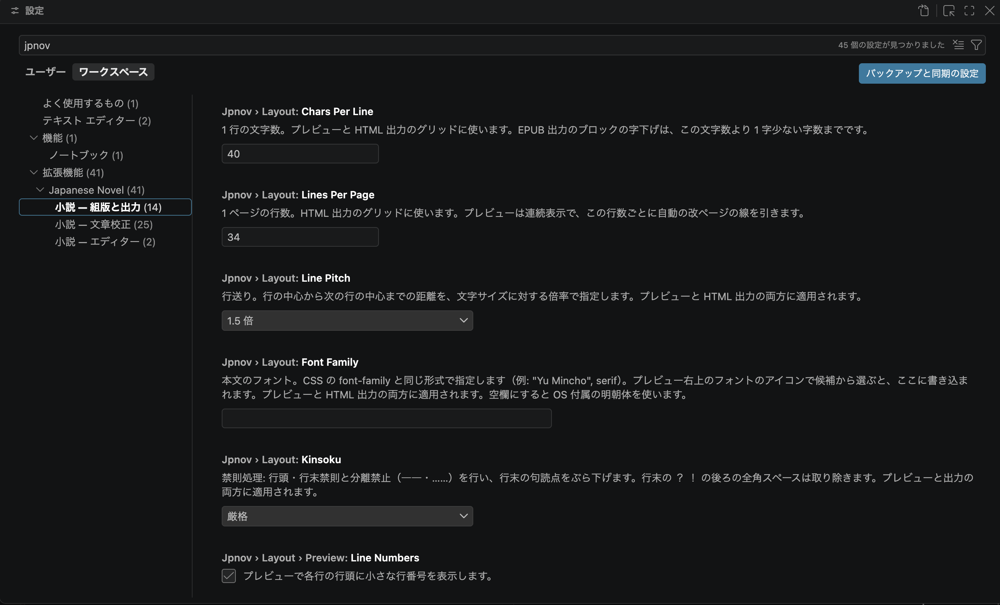

# Japanese Novel

日本語 ｜ [English](./README.en.md)

**書いて、確かめて、一冊にする。すべて縦書きのまま。**


*出力した本をそのまま印刷した結果です（夏目漱石『吾輩は猫である』・青空文庫より）*

「Japanese Novel」は、無料のエディター「Visual Studio Code（VS Code）」を小説の執筆環境に変える拡張機能です。書いた文章はすぐ隣に縦書きで表示され、章をまとめて HTML・EPUB・テキストの「本」として出力できます。出力した HTML はブラウザーでそのまま印刷・PDF 保存できます。記法は[青空文庫の注記][AozoraAnno]そのまま。原稿はただのテキストファイルです。

## できること

- **縦書きプレビュー** — 書きながら、組み上がった姿をすぐ隣で確認できます。
- **青空文庫の注記に対応** — ルビ・傍点・傍線・太字・斜体・縦中横・改ページなど。
- **自動字下げ** — 改行すると行頭に全角スペースが入ります。その行を `「` や `『` で書き始めると自動で外れます。
- **本づくり** — 章をまとめて、印刷用の HTML や EPUB・青空文庫形式のテキストなどに出力。HTML はそのまま印刷や PDF 保存できます。
- **文章校正** — 目に見えない不正な文字や、投稿前の体裁くずれに気づけます。
- **登場人物と造語のハイライト** — 人物の名前や造語が、地の文で目立つ表示になります。
- **注記の案内** — 注記にマウスを合わせると、何をする注記か、本文のどこにかかっているかが表示されます。対象文字列は F2 で本文と一緒に書き換えられます。


*ふだんの執筆画面です。左から、「本の一覧」・原稿・縦書きプレビュー*

## この拡張機能の考え方

機能の多さよりも、**執筆の邪魔をしないこと**を大切にしています。

### AI は使いません

小説の投稿や出版では、AI の利用を禁じる編集部や賞が少なくありません。この拡張機能は、**執筆のための AI 機能を一切持ち込みません**。`.jpnov`・`.jpbook` を開いている間は GitHub Copilot 拡張機能も既定で無効になり、入力補完はすべて、決まった規則にもとづくふつうのプログラムが行います。

**執筆は最初から最後まで、人間の手で。**

### 辞書を持ちません

単語辞書から「これは人名らしい」と推測して色を付けるような機能は、あえて持ちません。推測は外れるからです。

ありふれた言葉が人名として塗られたり、作品の要になる造語が見過ごされたり。目立たせたい言葉は、[登場人物と造語のハイライト](#登場人物と造語のハイライト)に作者自身が登録します。[文章校正](#文章校正)も同じ考えで、単語辞書に基づくあいまいな指摘はしません。辞書を積み込まないぶん、動作も軽いままです。

### 入れたら、それだけで動きます

追加のソフトも、プログラムの知識も要りません。プレビューも本づくりも手元のパソコンの中だけで完結するので、オフラインでも使え、原稿がどこかへ送られることもありません（印刷も、お使いのブラウザーで手元のファイルを開くだけです）。プレビューは入力のたびに、すぐ組み直されます。

### 原稿を囲い込みません

原稿はただのテキスト、記法は昔からある[青空文庫の注記][AozoraAnno]です。章のファイルは `.jpnov`、本のファイルは `.jpbook`。この拡張機能が働くのは、あなたが小説と決めたこの 2 つのファイルだけです。

## はじめかた

VS Code に慣れていなくても大丈夫です。順番にどうぞ。

1. **VS Code を入れる** — [公式サイト](https://code.visualstudio.com/)から無料でダウンロードして、インストールします。
2. **日本語表示にする** — VS Code を起動したら、左端の四角いブロックのアイコン（拡張機能）をクリックし、検索欄に `Japanese Language Pack` と入力してインストールします。案内に従って再起動すると、画面が日本語になります。
3. **この拡張機能を入れる** — 同じ検索欄に `jpnov` と入力してインストールします。
4. **小説のフォルダーを開く** — 原稿を入れるフォルダーを作り、メニューの「ファイル」→「フォルダーを開く」で開きます。開いたときに「このフォルダー内のファイルの作成者を信頼しますか?」と聞かれたら、「はい、作成者を信頼します」を選んでください。自分で作ったフォルダーなので心配ありません。フォルダーを開かなくても本は作れますが、開いておくと、その中の本が「本の一覧」に自動で並び、章ファイルの名前を変えても目次はそのまま使えます。
5. **本を作る** — 左端のアクティビティバーの「小説」（本のアイコン）を開き、「本の一覧」の「＋」（本を作成…）を押して、本の名前を入力します（末尾の `.jpbook` は最初から入っています）。`.jpbook` 1 つが本 1 冊です。作った本がそのまま開き、「本の情報」「表紙」「目次」が現れます。一覧の下には、本文のページ数・原稿用紙換算枚数・文字数が出ます。
6. **章を書く** — 「目次」の「章を追加…」を押すと、章ファイルを選ぶ画面が出ます。章の名前を入力して Enter を押してください（ファイル名には `.jpnov` が自動で付きます。この `.jpnov` が「小説の章」の目印です）。作った章は目次に加わり、そのままエディターで開きます。あとは書くだけです。
7. **縦書きで確かめる** — 章を開いた状態で、エディター右上の「プレビューを横に開く」アイコンを押すと、エディターの横に縦書きの組み上がりが表示されます。書くそばから反映されます。
8. **本にする** — 「本の一覧」の下にある「印刷／PDF 保存」を押すと、本がブラウザーで開きます。ページ右上の「印刷／PDF 保存」からそのまま印刷でき、プリンターの代わりに PDF への保存を選べば PDF になります。出力した HTML は、開いているフォルダーの `dist` にあります。本が増えたら、一覧に戻ってチェックを入れると、まとめて出力できます。


同じ流れは、「ようこそ」画面（メニューの「ヘルプ」→「ようこそ」）にあるガイド「小説をはじめる」でも案内しています。

## 書き方（青空文庫の注記）

本文はふつうに書くだけです。ルビや傍点を付けたいところにだけ、[青空文庫の注記][AozoraAnno]という決まった書き方を添えます。青空文庫は日本語の電子テキストで長く使われてきた形式です。

多くの注記は、対象の言葉を後ろから指す**前方参照型**が基本です。範囲がわかりにくいときは前後ではさむ**開始／終了型**、複数行にわたるときは開始と終了の注記をそれぞれ 1 行にして囲む**ブロック型**でも書けます。どの形でも仕上がりは同じです。

| やりたいこと | 前方参照型 | 開始／終了型 | ブロック型 |
| --- | --- | --- | --- |
| ルビを振る | `漢字《かんじ》` | `｜お茶の間《おちゃのま》` | — |
| 左側にルビを振る | `英雄［＃「英雄」の左に「ヒーロー」のルビ］` | — | — |
| 傍点を打つ | `言葉［＃「言葉」に傍点］` | `［＃傍点］嬉しい［＃傍点終わり］` | — |
| 傍線を引く | `言葉［＃「言葉」に傍線］`（傍線・二重傍線・鎖線・破線・波線） | `［＃傍線］大事な約束［＃傍線終わり］` | — |
| 左側に傍点・傍線を付ける | `言葉［＃「言葉」の左に傍点］` | `［＃左に傍点］嬉しい［＃左に傍点終わり］` | — |
| 太字にする | `言葉［＃「言葉」は太字］` | `［＃太字］ここぞ［＃太字終わり］` | `［＃ここから太字］…［＃ここで太字終わり］` |
| 斜体にする | `言葉［＃「言葉」は斜体］` | `［＃斜体］そっと［＃斜体終わり］` | `［＃ここから斜体］…［＃ここで斜体終わり］` |
| 数字などを 1 マスに収める（縦中横） | `42［＃「42」は縦中横］`（3 字まで。長いと波線でお知らせします） | `［＃縦中横］12［＃縦中横終わり］` | — |
| 見出しを付ける | `第一章［＃「第一章」は大見出し］`（大見出し・中見出し・小見出し） | `［＃大見出し］第一章［＃大見出し終わり］` | `［＃ここから大見出し］…［＃ここで大見出し終わり］` |
| 字下げする | 全角スペース、または `［＃２字下げ］`（その場所に全角スペース２つ分。数字は全角で、９９まで） | — | `［＃ここから２字下げ］…［＃ここで字下げ終わり］` |
| ページを改める | `［＃改ページ］`（行の頭で） | — | — |


上の見本は、左ルビがあるので行送りを 2 倍にしています。原稿はこちらです。コピーしてそのまま試せます。

```text
　物語《ものがたり》が始まる。
　｜お茶の間《おちゃのま》へ届け。
　覚悟［＃「覚悟」に傍点］を決めた。
　運命［＃「運命」に波線］が動く。
　英雄《えいゆう》［＃「英雄」の左に「ヒーロー」のルビ］の登場。
　第42［＃「42」は縦中横］話、太字［＃「太字」は太字］で。
「何だと!?［＃「!?」は縦中横］」
```

覚えておくと便利なこと：

- 注記の `［＃…］` は**すべて全角**で書きます。半角の `[#…]` は効きません。
- `!?` `!!` のような半角のペアは、そのままだと横倒しになって 2 マスを使います。波線が出たら、電球アイコンから `⁉` `‼` のような 1 文字に置き換えられます。設定「小説 — 文章校正」で、縦中横の注記を付ける直し方にも切り替えられます。
- `‼` `⁇` `⁈` `⁉` `¡` `¿` は、青空文庫の外字注記でも書けます。本文に `※［＃感嘆符疑問符、1-8-78］` と書くと、`⁉` 1 文字として表示されます。ほかの 5 つは `※［＃感嘆符二つ、1-8-75］`（`‼`）、`※［＃疑問符二つ、1-8-76］`（`⁇`）、`※［＃疑問符感嘆符、1-8-77］`（`⁈`）、`※［＃逆感嘆符、1-9-3］`（`¡`）、`※［＃逆疑問符、1-9-22］`（`¿`）です。
- `《》` は必ずルビの記号になります。本文で括弧として使うときは、外字注記で `スキル※［＃始め二重山括弧、1-1-52］聖剣※［＃終わり二重山括弧、1-1-53］` と書くと、`スキル《聖剣》` と表示されます。
- 左側にルビを振るときは、設定「小説 — 組版と出力」の行送り（Line Pitch）を 2 倍以上にします。狭いままだと、左ルビが隣の行に重なります。
- 見出しの注記がある行は、行全体が見出しになります。見出しの注記を書いても、章が分かれるわけではありません。**章＝ 1 ファイル**が区切りです。
- 対応していない注記はメモ扱いになり、出力には現れません。書きかけの注記（`］` の閉じ忘れ）は波線でお知らせします。開始／終了型・ブロック型で `［＃…終わり］` を書き忘れたときも、波線でお知らせします。
- 注記にマウスを合わせると、何をする注記か、本文のどこにかかっているか（開始／終了型なら対になる注記）が表示されます。注記や本文にカーソルを置くと、相手側も光ります。
- `言葉［＃「言葉」に傍点］` の `言葉` を直すときは、どちらかの `言葉` にカーソルを置いて F2（名前の変更）を押すと、本文と「」の中がまとめて書き換わります。文章校正の自動修正が本文を直したときも、「」の中は一緒に直ります。
- `《…》` の前にルビのかかる文字がないとき（行頭や句点・空白・注記の直後）は、ルビにならず文字のまま出力されるので、これも波線でお知らせします。電球アイコンから、二重山括弧の外字注記に書き換えられます。読みが空の `《》` も同じく波線でお知らせします。`｜` を付けると、間に注記があっても `｜` から `《` までがまとめてルビのかかる文字になります（`｜山田［＃「山田」に傍点］《やまだ》`）。

## 自動字下げ

和文では、段落の先頭に全角スペースを 1 つ置きます。この決まりに合わせて、スペースを自動で入れたり外したりします。

- 改行すると、次の行の行頭に全角スペースが 1 つ入ります。
- その行を `「` や `『` で書き始めると、このスペースは自動で外れます。
- 何も書かずにそのまま改行したときは、残ったスペースが消えて空行になります。
- 対象になるのは、自動で入れたスペースだけです。自分で入力したスペースはそのまま残ります。
- `［＃３字下げ］` はその場所に全角スペース 3 つ分として表示されます。自動で入ったスペースの後ろに書くと、合わせて 4 字分になります。

不要なときは、設定「小説 — エディター」でオフにできます。

## 1 語分の移動・選択・削除

⌥←・⌥→（Windows・Linux では Ctrl+←・Ctrl+→）を押すと、カーソルは文の途中の区切りごとに止まります。VS Code の既定では、行の端まで一気に飛びます。

- ⇧ を加えると、止まる位置まで選択します。
- ⌥⌫・⌥⌦（Ctrl+Backspace・Ctrl+Delete）は、止まる位置まで削除します。

止まる位置は、文字の種類でおおまかに区切ったところです。次のものが、それぞれひとまとまりになります。

- 漢字や片仮名と、それに続く平仮名
- 平仮名だけの並び（`ぱっともらった` など）
- 句読点や空白の並び（開き括弧の前と、閉じ括弧の後ろでは区切ります）

`聖剣を / 抜いたのは / 山田 / 　 / 太郎だった / 。`

日本語入力の変換中は、VS Code 本来の動きになります。不要なときは、キーボードショートカットの一覧で「小説」の「1 語分」コマンドの割り当てを外してください。

## 縦書きプレビュー

エディター右上の「プレビューを横に開く」で、原稿の横に組み上がりが表示されます。

- 入力するたびに、すぐ反映されます。
- エディターでカーソルを動かすと、プレビューも同じ場所へ移動します。
- 行の折り返しや禁則処理は、出力される本とまったく同じ計算です。
- `［＃改ページ］` は破線の目印として表示されます。1 ページの行数ごとに、自動の改ページの位置を薄い点線で示します。行番号は章の初めから通しです。

プレビューの右上に「40 字 × 34 行」と表示されています。押すと開き、1 行の文字数と 1 ページの行数をその場で変えられます。変えた値はプレビューだけに反映されます。設定と違う間は枠が黄色になり、アイコンが 2 つ現れます。保存アイコンを押すと、ユーザー設定か、開いているフォルダーのワークスペース設定に書き込めます。もう 1 つは、設定の値に戻すアイコンです。ほかの場所をクリックすると「40 字 × 34 行」の表示に戻ります。

行番号を消したいときや、原稿用紙のような罫線を出したいときは、設定「小説 — 組版と出力」で選べます。

## 本にする（印刷・EPUB・テキスト）

`.jpbook` は「本に載せる章を、読む順に並べた目次」です。中身はただのテキストで、章のファイル名（`.jpbook` があるフォルダーからのパス）が 1 行ずつ並びます。

```text
第一章.jpnov
第二章.jpnov
最終章.jpnov
```

本の中身と順序は、この目次だけが決めます。この仕組みは、長い作品ほど効いてきます。

- **巻ごとに 1 冊** — 長編は `第一巻.jpbook`・`第二巻.jpbook` と分ければ、最新巻だけを 1 冊にまとめて編集部に渡せます。
- **目次にある章だけが本になります** — 同じ第一章の別稿をいくつか持っておき、投稿先に合わせて目次の 1 行だけ差し替える、という使い方ができます。
- **ファイル名は自由** — 順序は目次が決めるので、章のファイルにどんな名前を付けても、あとで名前を変えても、本の並びは崩れません。

本にするには、アクティビティバーの「小説」を開きます。出力したい本にチェックを入れて、一覧の下のボタンを押します。ボタンは「印刷／PDF 保存」「テキスト」と、EPUB のアイコンの 3 つです。

- **印刷／PDF 保存** — 本をページ組版の縦書き HTML に出力して、既定のブラウザーで開きます。ページ右上の「印刷／PDF 保存」ボタンか、ブラウザーの印刷メニューからそのまま印刷できます。プリンターの代わりに PDF への保存を選べば PDF になります。用紙は A4（既定）か A6 を選べます。向きはページの形に合わせて自動で決まります（設定で固定もできます）。出力した HTML は 1 ファイルで完結し、あとから開き直しても印刷できます。ブラウザーは Chrome を推奨します。Firefox でも問題ありません。Safari は用紙サイズと向きの指定を読まないため、印刷にはおすすめしません。
- **EPUB** — 電子書籍の EPUB。スマートフォンや電子書籍リーダーで、縦書き・右開きのまま読めます。文字の大きさと行の折り返しは読む端末に合わせて変わります。ファイルの中では章ごとに分かれ、`［＃改ページ］` のところでも分かれます。
- **テキスト** — 章をつないだ青空文庫形式のテキスト。青空文庫のテキストを読めるソフトへの受け渡しに。`［＃…終わり］` を書き忘れたまま章が終わっても、次の章には続きません。章の切れ目で閉じます。

出力されるのは、エディターに表示されている内容です。まだ保存していない変更も、そのまま本に含まれます。

出力先は、開いているフォルダーの `dist` です。設定「小説 — 組版と出力」で変更でき、`dist` と書けば `.jpbook` と同じフォルダーの `dist` に、`../dist` と書けばその 1 つ上のフォルダーの `dist` に出力します。フォルダーを開かずに出力した場合は、`.jpbook` と同じフォルダーの `dist` です。出力ファイルの名前は `.jpbook` と同じです（`第一巻.jpbook` なら `dist/第一巻.html`）。開いているフォルダーの `dist` に出力するときは、そこからのフォルダーの名前を `-` でつなぎます（`○○賞/第一巻.jpbook` なら `dist/○○賞-第一巻.html`）。同じ名前の本を別のフォルダーに置いても、出力は重なりません。章のファイルは `.jpbook` と別のフォルダーに置けます。`.jpbook` より上のフォルダーにある章は `../第一章.jpnov` のように書きます。出力先が同じファイルになる 2 冊をまとめて出力すると、どちらも出力されず「出力に失敗しました」とお知らせします。

「本の一覧」は、開いているフォルダーの中の `.jpbook` を探して並べます。`.` で始まるフォルダーと `node_modules` の中、入れ子になった別のワークスペースフォルダーの中は探しません。フォルダーを開いていなくても、エディターで開いている `.jpbook` は「本の一覧」の「開いているファイル」に並び、同じように出力できます。

目次に誤り（足りない本の情報、`---` の書き忘れ、パス区切りの `\`、`.jpnov` 以外のファイルなど）がある本は出力されず、「出力に失敗しました」とお知らせします。該当行には赤い波線が付きます。ほかの本はそのまま出力されます。

**ふだんの操作は「本の一覧」でできます** — 本を開くと「本の情報」「表紙」「目次」が現れます。一覧の下の本文のページ数・原稿用紙換算枚数・文字数は、出力と同じ計算です。表紙は数えません。章を書き足すと、少し置いて更新されます。章を加えるには「章を追加…」を押します。すでにあるファイルはチェックを入れ、新しい章は名前を入力します。両方を一度に加えることもできます。並べ替えは、ドラッグか上下のボタンでできます。不要になった章は「×」で本から外せます（ファイルは残ります）。キーボードでは、↑・↓ で章を移り、⌥↑・⌥↓（Windows・Linux では Alt+↑・Alt+↓）で並べ替え、⌦・⌫（Delete・Backspace）で本から外し、Esc で一覧に戻れます。[応募用の表紙](#応募用の表紙と扉)も、「表紙」で同じように扱えます。タイトルやヘッダーは、「本の情報」の各行をクリックすればその場で編集できます。下の出力ボタンは、開いている本だけを出力します。どの操作も `.jpbook` の中身をそのまま書き換えるので、手で書いた場合と完全に同じ結果になります。

章のファイルや `.jpbook` 自体を VS Code 内で名前を変えたり移動したりすると、`.jpbook` に書かれたパスを更新するか確認が出ます（設定「小説 — エディター」で「常に更新」「更新しない」に変えられます）。`.jpbook` と章をまとめて移動した場合、パスはそのまま使えます。VS Code の外で変えた場合は追跡できないので、`.jpbook` の該当行に赤い波線でお知らせします。

## 組版の設定

既定の組版は **40 字 × 34 行**。字数・行数・行送り・本文のフォントは設定「小説 — 組版と出力」で変えられます。行送りの既定は文字サイズの 1.5 倍、本文のフォントの既定は OS 付属の明朝体です。

設定を開くには：左下の歯車 →「設定」→ 検索欄に `jpnov`（章ファイルの拡張子と同じ綴り・半角）と入力すると、この拡張機能の設定だけが並びます。



### 禁則処理

行の頭に句読点が来ない、行の末尾にかぎ括弧の開き（`「`）が残らない――和文組版の約束事は、既定で守られます。

| 禁則処理なし | 禁則処理あり（既定） |
| :---: | :---: |
|  |  |

行末の句読点は「ぶら下げ」で処理します。`？` や `！` が行末に来たときは、その後ろの全角スペースを次の行に送らずに取り除きます。既定の「厳格」では、小書きの仮名（っ・ゃ など）と長音記号（ー）も行頭に来ません（Word の「高レベル」に相当）。これらが行頭に来てもよい場合は、設定で「緩め」（Word の「標準」に相当）を選べます。

### ダッシュ

設定「小説 — 文章校正」で選べます。既定は全角ダッシュ `―`（U+2015）で、[青空文庫の記号](https://www.aozora.gr.jp/aozora-manual/index-input.html#symbol)と同じ文字です。em ダッシュ `—`（U+2014）と罫線 `─`（U+2500）も選べます。ほかのダッシュ文字や奇数個の連続は指摘され、電球アイコンから直せます。`－－`（全角ハイフンマイナス）と `––`（en ダッシュ）による代用も指摘されます。長音記号 `ー` はダッシュとして扱いません。

どれを選んでも、HTML・EPUB の出力では em ダッシュ（—）として組まれます。日本語のフォントでは、em ダッシュどうしが切れ目なく 1 本につながります。

### 原稿用紙風の表示

罫線と行番号をオンにすると、原稿用紙のような見た目になります。プレビュー用と出力用は、設定「小説 — 組版と出力」で別々に選べます。


*罫線を「赤」に、行番号をオンに、行送りを 2 倍にして印刷した例*

### ヘッダーとフッター

ページ組版の出力には、ヘッダー（ページ上部の文字）とフッター（ページ下部の文字。ふつうはページ番号）が入ります。これらは**本ごとの情報**なので、`.jpbook` の冒頭に書きます。同じフォルダーで第一巻と第二巻を作っても、ヘッダーをそれぞれ変えられます。章と章の間に入れる区切り記号（章区切り）も、同じ場所で指定します。

「本を作成…」で作った `.jpbook` には、本の情報が最初から入っています。1 行目は `jpbook/1`（`.jpbook` の書式とそのバージョン。いまは `1` です）で、書式が変わったときに、どの書き方のファイルかをこの行で見分けます。本の情報は `---` の行で終わり、その下に章を 1 行に 1 つずつ並べます。

```text
jpbook/1
title: 作品名
author:
header:
headerAlign: center
footer: ［＃ここに「ページ番号」の値を表示］ / ［＃ここに「総ページ数」の値を表示］
footerAlign: right
divider:
---
第一章.jpnov
```

- `title` — 本のタイトル。EPUB と「本の一覧」の表示に使われます。空にはできません。
- `author` — ペンネーム。EPUB の作者名になります。空にすると作者名は入りません。
- `header` — ヘッダー（ページ上部に入る文字）。空にすると何も表示されません。
- `headerAlign` — ヘッダーの配置。`right`（常に右上）・`left`（常に左上）・`rightLeft`（右上・左上を交互）・`leftRight`（左上・右上を交互）・`center`（中央）。
- `footer` — フッター（ページ下部に入る文字）。上の例の値で `12 / 215` のように出ます。空にすると何も表示されません。
- `footerAlign` — フッターの配置。`right`（常に右下）・`left`（常に左下）・`rightLeft`（右下・左下を交互）・`leftRight`（左下・右下を交互）・`center`（中央）。
- `divider` — 章区切り。章と章の間に入れる記号です（例：`＊`・`＊　＊　＊`・`◇`）。次の章が見出しで始まる場合は入りません。そのまま書けば出力時に天地中央揃えになり、`［＃３字下げ］＊` のように書けば字下げで入ります。空にすると章の間は空行だけになります。
- `cover` — 本文の前に入れるページ。応募用の表紙やあらすじに使います（[書き方](#応募用の表紙と扉)）。
- `characters`・`keywords` — 登場人物と造語の一覧。執筆中の地の文で目立つ表示になります（[書き方](#登場人物と造語のハイライト)）。

ヘッダーとフッターには、[表紙と同じ差し込みの注記](#応募用の表紙と扉)に加えて「ページ番号」（そのページの番号）が書けます。差し込み以外の注記やルビは、文字のまま出ます。

1 行目の `jpbook/1` と、本の情報を閉じる `---` の行は省けません。1 行目が `jpbook/1` でない本は出力されず、その行に赤い波線が付きます。本の情報のキーは、書かなければ空と同じです。`title`・`headerAlign`・`footerAlign` は空にできないので、書いていない本は出力されず、`---` の行に赤い波線が付きます。`cover`・`characters`・`keywords` は、あるときだけ書きます。編集中はキー名や値の候補が自動で出ます。本を「本の一覧」で開けば、`title` から `divider` までは「本の情報」で、`cover` は「表紙」で、`characters`・`keywords` は「登場人物」「造語」で編集することもできます。

### 応募用の表紙と扉

多くの新人賞では、本文の前に表紙や扉、あらすじといったページが要ります。`cover` に並べたファイルが、そのページになります。

```text
jpbook/1
title: 作品名
author: ペンネーム
header:
headerAlign: center
footer: ［＃ここに「ページ番号」の値を表示］ / ［＃ここに「総ページ数」の値を表示］
footerAlign: right
divider:
cover:
  - 表紙.jpnov
  - あらすじ.jpnov
---
第一章.jpnov
```

パスの書き方は章の行と同じです。表紙が 1 つだけなら、`cover: 表紙.jpnov` のように `cover:` と同じ行に書けます。表紙はファイルごとに新しいページから始まり、HTML 出力に入ります（そこから保存した PDF にもそのまま入ります）。ページ番号とヘッダーは本文の 1 ページ目から始まり、表紙が何ページあっても数え方は同じです。

「本の一覧」で本を開くと「表紙」があり、章と同じようにファイルの追加・作成・並べ替えができます。下の見本は、「表紙を追加…」で新しく作ったファイルにあらかじめ入っています。

表紙のファイルには、本の情報を差し込む注記が書けます。

| 差し込むもの | 注記 |
| --- | --- |
| タイトル | `［＃ここに「タイトル」の値を表示］` |
| ペンネーム | `［＃ここに「ペンネーム」の値を表示］` |
| 総ページ数（本文のページ数） | `［＃ここに「総ページ数」の値を表示］` |
| 原稿用紙換算枚数（本文を４００字詰め原稿用紙に換算した枚数） | `［＃ここに「原稿用紙換算枚数」の値を表示］` |

```text
［＃５字下げ］［＃ここに「タイトル」の値を表示］
［＃７字下げ］［＃ここに「ペンネーム」の値を表示］
［＃７字下げ］全［＃縦中横］［＃ここに「総ページ数」の値を表示］［＃縦中横終わり］ページ
［＃７字下げ］４００字詰め原稿用紙換算［＃縦中横］［＃ここに「原稿用紙換算枚数」の値を表示］［＃縦中横終わり］枚
```

出力すると、その本の値が入ります。プレビューには既定の値が出ます。タイトルとペンネームは「タイトル」「ペンネーム」、総ページ数と原稿用紙換算枚数は `0` です。同じ表紙ファイルを、何冊の本にも使えます。見出しや傍点を付けるときは、開始／終了型で挟みます（`［＃大見出し］［＃ここに「タイトル」の値を表示］［＃大見出し終わり］`）。

「ページ番号」の既定の値も、総ページ数と同じ `0` です。ほかの名前を書くと、その名前がそのまま出ます（`［＃ここに「13」の値を表示］` なら `13`）。本の値が入るのは表紙・ヘッダー・フッターだけで、本文の章に書いた注記には既定の値が出ます。値の注記がある行では、ほかの注記の対象文字列の誤りは指摘されません。

原稿用紙換算枚数は、本文を４００字詰め原稿用紙（縦書き 20 字 × 20 行）に組み直したときの枚数です。注記と禁則処理の扱いは出力と同じです。天地中央揃えの章区切りは、行頭に置いたものとして数えます。「本の一覧」で本を開いたときにも、同じ値が出ます。

## 文章校正

書いている間、原稿を静かに点検します。

点検は、地の文・台詞・見出し・ルビの読み・注記を区別して行われます。地の文の規則が台詞の中で働くことはなく、見出しの行は句点の確認から外れます。注記をまたいだ漢字の連続（聴覚視覚［＃太字］区分装置）は、読者に見えるとおりひとつながりとして数えます。単語辞書による推測もしないので、作品の固有名詞はそのまま通ります。

- **既定でオン（文字の事故）** — 半角カナ、濁点・半濁点が別の文字に分かれた仮名、Shift JIS にない文字（旧字体や異体字）、ゼロ幅スペース、不正な制御文字、行末のスペース、全角文字の間や半角の `!?` の後ろの半角スペース、ダッシュの揃え。コピー＆ペーストで紛れ込む「見えない事故」を防ぎます。
- **既定でオン（原稿の作法）** — 地の文は行頭の字下げと文末の句点。台詞は「〜。」の句読点と行頭の字下げを指摘。ほかに！？の直後の全角スペース、半角の `!?` の 1 文字への置き換え、三点リーダーの偶数個、括弧の対応。ひとつずつ独立した項目なので、合わない作法だけオフにできます。
- **投稿前にオン** — 一文の長さ、読点の数、漢字やアラビア数字の連続、空行の連続など。設定「小説 — 文章校正」で必要なものだけ選べます。

指摘は理由ごとに別の文言で表示され、多くは電球アイコンから自動修正できます。まとめて直したいときは「自動修正できる問題をすべて修正」も使えます。自動修正が直した本文を注記が指しているとき（`なに！と［＃「なに！と」に傍点］` の `！` の後に空白を入れるなど）は、注記の「」の中も一緒に直ります。


## 登場人物と造語のハイライト

登場人物の名前と、作品だけの造語を登録しておくと、執筆中に目立つ表示になります。日本語は主語が省略されがちなので、「いま誰の場面か」を見失いにくくなります。

色が付くのは、登録した言葉と、組み込みの代名詞（私・僕・俺・彼・彼女・あたし・わたくし・わし・少年・少女）だけです。辞書で推測しないので、関係ないふつうの言葉が塗られることはなく、どんなに珍しい名前や造語でも取りこぼしません。

- **登場人物**は、主語として読める場所（「太郎は」「山田さんが」など）だけ色が付きます。会話文（「」の中）には色が付きません。組み込みの代名詞も同じ規則で色が付きます。
- **造語**は地の文で太字になります。同じ言葉を両方に登録した場合、主語として読める場所では登場人物、それ以外は造語として扱われます。

登録は `.jpbook` に書きます。登場人物は `characters`、造語は `keywords` で、表紙と同じ並べ方です。

```text
jpbook/1
title: 作品名　第一巻
author: ペンネーム
headerAlign: center
footer: ［＃ここに「ページ番号」の値を表示］ / ［＃ここに「総ページ数」の値を表示］
footerAlign: right
characters:
  - 山田　太郎
  - 山田《やまだ》花子《はなこ》
  - John Smith
keywords:
  - 王都《おうと》
---
第一章.jpnov
```

- 項目には本文と同じルビが書けます。ルビ以外の注記は書けません（書いた項目には黄色い波線が付き、無視されます）。
- 姓と名は、スペースとルビの切れ目で分かれます。`山田　太郎`・`山田《やまだ》花子《はなこ》`・`山田｜花子《はなこ》` はどれも姓と名に分かれ、姓だけ・名だけでも色が付きます。`｜山田花子《やまだはなこ》` と `山田花子` は分かれません。ルビの親文字は本文と同じ規則（同じ字種の続き）で決まるので、`山田太郎《たろう》` は 1 語です。
- 認識は本文の親文字に対して行います。本文に `山田花子は` と書いても `山田《やまだ》花子《はなこ》は` と書いても同じです。本文の読みが `.jpbook` と違っても、何も言いません。
- 同じフォルダー（開いているフォルダーのうち、その章にいちばん近いもの）にある全ての `.jpbook` の一覧を合わせて使います。章がどの本に入っているかは見ません。シリーズの各巻に同じ名前を書く必要はなく、初めて登場する巻に書けばよいです。同じ名前を別の書き方（ルビや区切り）で書いた巻があると、両方に黄色い波線が付きます（先に見つかったほうが使われます）。
- 本を「本の一覧」で開けば、「登場人物」「造語」で追加・編集・削除できます。


## よくある質問

**Q. 原稿は独自の形式に囲い込まれますか？**
いいえ。`.jpnov` も `.jpbook` も中身はただのテキストです。どのエディターでも開けますし、[青空文庫の注記][AozoraAnno]はこの拡張機能がなくても意味が通ります。

**Q. いま書いている原稿からの引っ越しは大変ですか？**
本文を `.jpnov` ファイルに貼り付けるだけです。Word などの装飾（ルビや太字）は引き継がれないので、注記で付け直してください。

**Q. 原稿はどこかに送信されますか？**
いいえ。原稿は手元のフォルダーに保存されるだけで、この拡張機能が外部へ送ることはありません。

**Q. 以前の原稿やこの拡張機能で出力したテキスト、または青空文庫からダウンロードした `*.txt` を VS Code で開いたら、文字が「&#xFFFD;」だらけになりました。**
文章はそのまま入っていますので、ご安心ください。右下から開き直すと読めます。

1. ウィンドウ右下の「UTF-8」をクリックします。

   

2. 一覧から「エンコード付きで再度開く」（英語で「Reopen with Encoding」）を押して、続けて「JIS」を入力し、「Japanese (Shift JIS)」を選びます。

   

テキスト出力の既定は、青空文庫と同じ Shift JIS という日本語専用のエンコード（文字コード）です。Shift JIS にない `‼` `⁇` `⁈` `⁉` `¡` `¿` は、外字注記に書き換えて出力します。UTF-8 で出力したいときは、設定「小説 — 組版と出力」で選べます。Shift JIS を使わないなら、設定「小説 — 文章校正」で Shift JIS にない文字の警告をオフにできます。

毎回の選び直しが手間なときは、設定の検索欄に `files.autoGuessEncoding` と入力し、出てきた項目にチェックを入れてください。以降は、出力したファイルをそのまま開けます。Windows のメモ帳など、ほかのアプリで保存した原稿をよく扱う方にも、この設定がおすすめです。

本にするときも、エディターがその原稿を開くのと同じエンコードで読み込みます。エディターで正しく読めている原稿は、Shift JIS のままでも正しく出力できます。「&#xFFFD;」に見えたままの原稿は出力してもそのままなので、先に上の手順で読めるようにしてください。

**Q. 電球アイコンのメニューに、✨ マーク付きの「Fix」など見覚えのない項目が出てきます。**
それは VS Code 本体に組み込まれている AI 機能（GitHub Copilot）のもので、この拡張機能とは関係ありません。押さなければ何も起こりません。表示そのものを消したい場合は、設定の検索欄に `chat.disableAIFeatures` と入力し、出てきた項目にチェックを入れてください。AI 関連の表示がまとめて消えます。

**Q. 見出しや目次ページは作れますか？**
見出しは注記で付けられます（[書き方の表](#書き方青空文庫の注記)をどうぞ）。付けた行はゴシック体の太字になり、字の大きさは変わりません。目次ページはいまのところ作れません。章＝ 1 ファイルで区切り、`.jpbook` の並び順がそのまま本の順序になります。

**Q. 既定のフォントで作った PDF を、印刷所に入稿したり販売したりしてもいいですか？**
はい。既定のフォントは OS 付属の明朝体で、macOS ではヒラギノ明朝、Windows では游明朝です（どちらもないときは無償の Noto Serif JP）。いずれも、成果物の商用利用と PDF への埋め込みがライセンスで認められているので、印刷所への入稿も、頒布・販売もそのままできます。設定で市販のフォントを指定する場合は、そのフォントのライセンスで PDF への埋め込みが認められているかをご確認ください。

**Q. Safari で印刷すると、用紙の向きが違います。**
Safari は、出力した HTML が持っている用紙サイズと向きの指定を読みません。印刷には Chrome または Firefox をお使いください。どうしても Safari を使う場合は、印刷ダイアログで用紙を「A4」（A6 で出力したなら「A6」）にし、向きを本に合わせて選び（既定の設定では横向きです）、ヘッダーとフッターの印刷はオフのままにしてください。

**Q. 自分は Copilot を使いたいのですが。**
`.jpnov`・`.jpbook` では既定で無効にしていますが、設定の `github.copilot.enable` を上書きすれば戻せます。有効にする場合は、投稿先や賞の規約をご確認ください。

## ライセンス

このプロジェクトは MIT ライセンスで公開されています。詳しくは [LICENSE](./LICENSE) をご覧ください。

[AozoraAnno]: https://www.aozora.gr.jp/annotation/index.html
